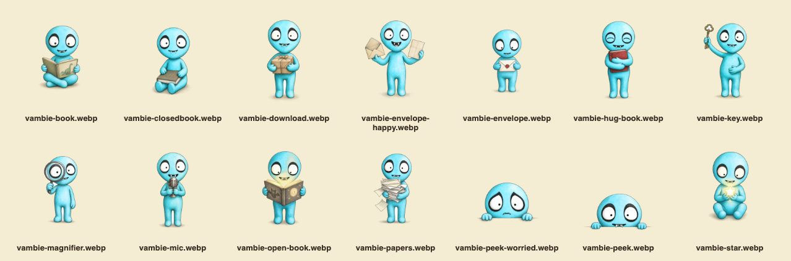

# Design system

How Vambie looks: the app, its Baby Vambie artwork, and the picture books it makes.

## The app

The picture-book look (VSB-124): the app looks like the books it makes. Warm cream paper, ink-brown text and lines, Vambie aqua for the main action on each screen, soft watercolor washes for cards, Fraunces titles, and Baby Vambie in the books' own pen-and-ink and watercolor. Family screens are designed for phones first. The reader switches to a two-page spread on tablets held sideways.

The admin panel keeps the original look (black chrome, Anton headlines, lime and purple). `.admin-shell` in `src/index.css` re-declares the original token values, so the admin doesn't change when the family tokens do. The admin's phone preview of a prompt card takes the family look, because it previews what families see.

### Colors

The colors are CSS variables at the top of `src/index.css`. Some keep their old names, so the names describe their role, not their color.

| Token | Value | Used for |
| --- | --- | --- |
| `--black` | `#f4ecd3` | Paper: the app background, top bars, tab bar |
| `--cream` | `#fbf6e8` | Card paper: panels (sheets) and cards |
| `--ink` / `--on-dark` | `#3b2e24` | Text and lines |
| `--ink-3` / `--on-dark-2` | `#6e5e50` | Notes and secondary text |
| `--line` / `--dark-line` | `#e2d6bd` / `#d6c8ab` | Dividers and borders |
| `--lime` / `--purple` | `#86d6d0` | Vambie aqua: the main action, selected options (ink text on top) |
| `--accent-text` / `--purple-ink` | `#1f6f6b` | Deep aqua: links and small accent text |
| `--accent-border` | `#3b2e24` | Ink edges on buttons and selected options |
| `--wash-lilac`, `--wash-butter`, `--wash-peach`, `--wash-sage` | `#e4dcef`, `#f6e7b8`, `#f6dcc4`, `#dfe8cf` | Prompt cards and featured cards |
| `--amber`, `--green`, `--red` | unchanged | Warnings, done, deleting and errors |

### Type

| Font | Used for |
| --- | --- |
| Fraunces | Headlines and titles, in sentence case; a second line in italic aqua on the welcome screen |
| Nunito | Everything else: buttons, labels, body text and form fields |
| Barlow ExtraBold | The VAMBIE wordmark, unchanged |
| Source Serif 4 | The story text in the reader |

Fraunces runs wider than the old condensed headline font, so display sizes are multiplied by `--display-scale` (0.74), titles by `--title-scale` (0.92) and buttons by `--button-scale` (0.9). The admin sets each scale to 1. All the fonts are loaded from Google Fonts in `index.html`.

### Components

The shared building blocks are in `src/components/ui.tsx`, and their styles are in `src/index.css`.

| Component | What it is |
| --- | --- |
| `Masthead` | The header with a Fraunces headline, optional subtitle and badge, and Baby Vambie art |
| `Sheet` | The card-paper panel under a masthead. `peek` puts Baby Vambie peeking over its top edge. |
| `Note` | A callout for information, warnings, success or plain notes |
| `StepRow` | One row of a progress list: done, in progress, waiting, held or failed |
| `MenuRow` | A row in a settings-style list, with an icon, title, subtitle and chevron |
| `Field`, `Select`, `Check`, `CheckMark`, `RadioCard`, `RadioRow`, `Switch`, `Segmented` | Form controls |
| `ProgressSteps` | The "Step 1 of 4" indicator in setup |
| `Avatar` | A person's initials or picture, or Baby Vambie for "you" |
| `BottomSheet` | A sheet that slides up from the bottom, like reading settings and memory options |
| `Mascot` | Baby Vambie artwork by name |

Buttons use the `.btn` class with a variant: `--lime` for the main action (aqua), `--purple`, `--dark` (ink with light text), `--outline`, `--ghost`, `--danger` or `--soft`. `--caps` gives the headline-button style: Nunito ExtraBold in the family app, Anton capitals in the admin. `--sm` and `--xs` are smaller sizes.

The other shared pieces are `TopBar` (back button, wordmark or title, and actions), `BottomNav` (Home, Book, Memories, Family), `AudioPlayer` (play button with the recording's real waveform) and `PagePicture` (a page picture in its size).

## Baby Vambie artwork

The app's Baby Vambie poses are in `public/art/book/`. They're painted in the books' pen-and-ink and watercolor, from Baby Vambie's book-style reference art (`uploads/characters/baby_vambie-book-style-*.png`), with `gpt-image-2`. That model can't paint transparent backgrounds, so each pose was painted on cream paper. The paper was then white-balanced and taken out: only paper connected to the picture's edges is removed, so eye whites and book pages stay solid. They sit well on paper, card paper, aqua and the washes. They aren't made for dark backgrounds.

| File | Pose | Where it's used |
| --- | --- | --- |
| `vambie-peek.webp` | Peeking over a ledge | On top of panels, avatars, the browser-tab icon |
| `vambie-peek-worried.webp` | Peeking, worried | Something needs another try |
| `vambie-book.webp` | Reading a picture book | Sign in |
| `vambie-open-book.webp` | Holding up a glowing open book | A chapter is being made |
| `vambie-hug-book.webp` | Hugging a book | Saved, account deleted |
| `vambie-closedbook.webp` | A closed book on its lap | Empty storybook |
| `vambie-star.webp` | Cradling a little star | Invitations, prompt cards |
| `vambie-mic.webp` | Holding a microphone | Recording, microphone help |
| `vambie-key.webp` | Holding up a key | Checking a sign-in code |
| `vambie-envelope.webp` | Holding a sealed envelope | Invitation problems |
| `vambie-envelope-happy.webp` | An opened letter | Invitation request sent |
| `vambie-magnifier.webp` | Looking through a magnifying glass | No search results, Who's in the pictures, Help |
| `vambie-papers.webp` | Carrying a stack of papers | Preparing an export, chapter in review |
| `vambie-download.webp` | Carrying a parcel | Export ready |

The welcome screen's painting is `public/art/book/landing.jpg`, blended onto the paper with `background-blend-mode: multiply`. The original 3D poses and the night-forest backdrops are still in `public/art/`. The admin uses the backdrops behind artwork thumbnails.

## The picture books

Story pictures follow a different art direction from the app: a classic picture book, inspired by *Where the Wild Things Are* and *Frog and Toad*.

- Expressive pen-and-ink line with fine cross-hatching, finished with transparent watercolor washes. Ink first, wash second, with no 3D shading or glossy surfaces.
- A muted, earthy palette (sage, olive, ochre, warm browns, with dusky blue and violet for night and big feelings). The Vambies' own colors, like Baby Vambie's aqua, are the only bright ones.
- Warm cream paper texture. Simple faces, with feelings shown through posture and small gestures.
- Faces and the key action stay in the central 80% of the frame, so pictures can be trimmed for different screens.
- No words, letters or numbers in any picture. The story text is set below it.

Characters are drawn in this style even when their reference art is a 3D render. The art direction is edited in Admin → Settings → Page rules, and each chapter keeps the version it was drawn with.
